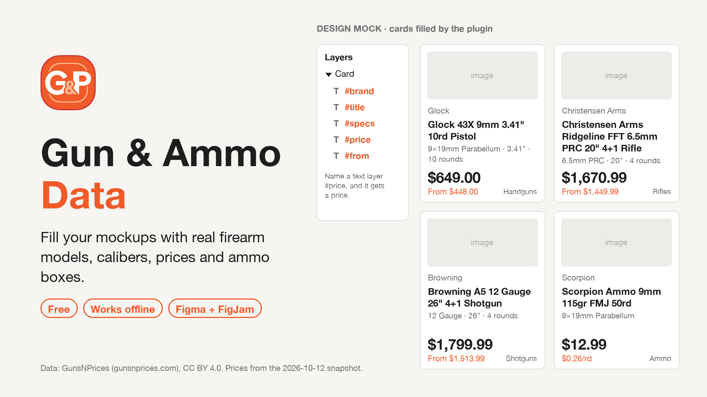

# Gun & Ammo Data, a plugin for Figma and FigJam

[](https://github.com/gunsnprices/figma-gunsnprices/actions/workflows/ci.yml)

Fill mockups for gun stores, ammo shops, shooting ranges and price comparison apps with real data: firearm models,
brands, calibers, product titles, prices, magazine capacity, barrel length, ammo boxes and cost per round. "Lorem ipsum"
and "Product name" don't show you how a 60-character rifle title wraps or what `$1,799.99` does to a price badge.



The data is a snapshot of the catalog of [GunsNPrices](https://gunsnprices.com), a price comparison site that tracks
40+ US gun and ammo stores, and it ships inside the plugin. The plugin makes no network requests
(`"allowedDomains": ["none"]` in the manifest), collects nothing and needs no account.

## How to use it

1. Name the text layers of a card after what they should hold: `#title`, `#caliber`, `#price` ...
2. Select the card, several cards, or a frame that holds a list or grid of cards.
3. Run **Plugins → Gun & Ammo Data → Fill with gun & ammo data**, pick Handguns, Rifles, Shotguns or Ammo, and click
   **Fill selection**.

Each card gets its own row, and every tagged layer in a card comes from the same gun or ammo box, so the caliber and
the price match the title. Three cards with `#title`, `#specs`, `#price` and `#from` layers, filled with Handguns,
"Popular first":

| Card | `#title` | `#specs` | `#price` | `#from` |
|---|---|---|---|---|
| 1 | Glock 43X 9mm 3.41" 10rd Pistol | 9×19mm Parabellum · 3.41" · 10 rounds | $649.00 | From $448.00 |
| 2 | Heritage Rough Rider .22 LR 6.5" 6-Shot Revolver | .22 LR · 6.5" · 6 rounds | $159.99 | From $89.99 |
| 3 | Glock 19 Gen 5 9mm 4.02" 15rd Pistol | 9×19mm Parabellum · 4.02" · 15 rounds | $757.49 | From $500.99 |

The same cards filled with Ammo:

| Card | `#title` | `#specs` | `#price` | `#from` |
|---|---|---|---|---|
| 1 | Scorpion Ammo 9mm 115gr FMJ 50rd | 9×19mm Parabellum · 50 rounds · $0.26/rd | $12.99 | From $12.99 |
| 2 | RIO Royal Star 2.75" 12 Gauge Ammo, 5/box | 12 Gauge · 5 rounds · $0.99/rd | $4.95 | From $4.95 |
| 3 | CCI Blazer .22LR 40gr LRN Ammunition, 425rds | .22 LR · 425 rounds · $0.08/rd | $33.99 | From $33.99 |

New to it? Click **Create 3 sample cards** (Figma Design files): it adds three cards with tagged layers next to your
work and fills them.

### Panel options

| Option | |
|---|---|
| Handguns / Rifles / Shotguns / Ammo | What to fill with: 1,045 handguns, 740 rifles, 320 shotguns, 736 ammo boxes |
| Brand, Caliber | Narrow it down, e.g. only Sig Sauer, only 12 Gauge. Counts are shown next to each name |
| Popular first / Random | Popular first starts with the most listed models (for ammo: one box of each popular caliber in turn). Random gives new rows every click |
| Untagged text | What a text layer **you selected directly** gets when its name has no tag. "Leave as is" turns it off |

The panel remembers your choices (in Figma's local plugin storage, on your computer).

## Tags

A tag is `#` and a field name anywhere in the layer name: `#price`, `Price #price`, `#price copy 2` all work, and case
doesn't matter. A text layer you renamed to just the field name (`Price`, `Cost per round`) works too; a layer that
still carries its automatic name (its own text) does not, so a "Price" label stays a label.

| Tag | Also | Handgun example | Ammo example |
|---|---|---|---|
| `#title` | `#name`, `#product` | Glock 19 Gen 5 9mm 4.02" 15rd Pistol | Scorpion Ammo 9mm 115gr FMJ 50rd |
| `#brand` | `#manufacturer`, `#make` | Glock | Scorpion |
| `#model` | | Glock 19 Gen 5 | (guns only) |
| `#family` | `#series` | Glock 19 | (guns only) |
| `#caliber` | `#calibre`, `#cal`, `#chambering` | 9×19mm Parabellum | 9×19mm Parabellum |
| `#type` | `#category` | Handgun | Handgun ammo |
| `#price` | `#cost` | $757.49 | $12.99 |
| `#price-min` | `#lowest-price` | $500.99 | $12.99 |
| `#from` | `#price-from` | From $500.99 | From $12.99 |
| `#capacity` | `#mag`, `#magazine` | 15 rounds | (guns only) |
| `#barrel` | `#barrel-length`, `#bbl` | 4.02" | (guns only) |
| `#rounds` | `#count`, `#rounds-per-box` | (ammo only) | 50 rounds |
| `#cpr` | `#cost-per-round`, `#price-per-round` | (ammo only) | $0.26/rd |
| `#cpr-cents` | `#cents-per-round` | (ammo only) | 26¢/rd |
| `#specs` | `#subtitle`, `#details` | 9×19mm Parabellum · 4.02" · 15 rounds | 9×19mm Parabellum · 50 rounds · $0.26/rd |

A field that doesn't apply (`#cpr` on a rifle card) leaves the layer as it is, and the result message says how many
were skipped. An unknown tag such as `#rating` is reported and left alone.

### How cards are found

- Inside a selected frame, group, component or instance, only tagged text layers are filled. Buttons and labels
  ("Add to cart") stay as they are.
- A frame is one card, unless it uses the same tag more than once and looks like a list: two of its children carry the
  same tags, or a child repeats a tag. Then each child is a card. So a list, a grid, or a grid of rows of cards gives
  one row per card, and a heading next to the grid (`#brand`) is filled on its own.
- Selected text layers that share a parent form one card, unless a tag repeats among them; then each gets its own
  row. Selecting ten untagged text layers fills them with ten different titles, models or prices.
- Cards are filled in reading order: top to bottom, then left to right.
- When a filter leaves fewer rows than cards, rows repeat and the message says so.
- Layers whose font is missing are skipped; mixed fonts in one layer are loaded and the text takes the style of its
  first character, as when you type over it.

In **FigJam**, stickies and shapes with text are filled like text layers: select a few stickies, set "Untagged text"
to Model, and fill.

## Normalize caliber text

**Plugins → Gun & Ammo Data → Normalize caliber text** rewrites caliber spellings in the selected text layers (and in
text layers inside selected frames) as standard names, using the [`gunsnprices`](https://www.npmjs.com/package/gunsnprices)
parser and its list of 293 calibers. Text that is more than a caliber, such as a product title, is left alone.

| Before | After |
|---|---|
| `9MM LUGER` | `9×19mm Parabellum` |
| `5.56 NATO` | `5.56×45mm NATO` |
| `12ga` | `12 Gauge` |
| `300 BLK` | `.300 AAC Blackout` |
| `22LR` | `.22 LR` |
| `9mm +P` | `9×19mm Parabellum +P` |
| `.357 Mag / .38 Spl` | `.357 Mag / .38 S&W Special` |
| `Caliber: 9mm Luger` | `Caliber: 9×19mm Parabellum` |
| `Glock 19 Gen 5 9mm` | unchanged (not just a caliber) |

## The data

| | |
|---|---|
| Firearms | 2,105 models from 49 brands: 1,045 handguns, 740 rifles, 320 shotguns |
| Ammo | 736 boxes from 38 brands in 85 calibers |
| Calibers | 284 handgun, rifle, rimfire and shotgun calibers (for normalizing: 293) |
| Prices | in-stock US store prices on 2026-10-12, before shipping and tax |

Where it comes from:

- **Models, brands, calibers and prices**: the open [firearm datasets](https://github.com/gunsnprices/firearm-datasets)
  of GunsNPrices (`models/models.csv`, `calibers/calibers.csv`). Only models that were in stock with a price are
  included. `#price` is the median in-stock price of the model's listings, `#price-min` and `#from` the lowest one
  (when the lowest is less than half the median, it is usually a part sold under the model's name, so the median is
  shown instead).
- **Capacity and barrel length**: the most common values in the store titles of that model in the GunsNPrices
  catalog, read by the `gunsnprices` parser. The product title is built from model, caliber, barrel and capacity, and
  kept only if the parser reads all four back from it.
- **Ammo titles and box prices**: real store titles from the same catalog snapshot, with part numbers removed. Only
  boxes in stock, in title case, with the round count in the title and a plausible cost per round.

It is a one-day snapshot for mockups, not a price list. For current prices see [gunsnprices.com](https://gunsnprices.com).
`npm run data` rebuilds `src/data/catalog.json` from a checkout of the datasets (see `scripts/build-data.mjs`).

## Development

```bash
npm install
npm run build        # dist/code.js and dist/ui.html
npm test             # typecheck, build, unit tests and tests of the built plugin against a mock of the Figma API
```

To run it in Figma: Figma desktop app → **Plugins → Development → Import plugin from manifest...** → `manifest.json`.
`node build.mjs --watch` rebuilds on save.

The code is in `src/core` (data, tags, card grouping, caliber text; no Figma API), `src/plugin/code.ts` (Figma main
thread) and `src/ui` (panel). `npm run assets` renders the listing images in `assets/` with Pillow.

## License

Code: MIT. Data in `src/data/catalog.json`: [CC BY 4.0](https://creativecommons.org/licenses/by/4.0/), see
[LICENSE-DATA](LICENSE-DATA). **Data: GunsNPrices (gunsnprices.com), CC BY 4.0.**

Questions and corrections: app@gunsnprices.com or [GitHub issues](https://github.com/gunsnprices/figma-gunsnprices/issues).
